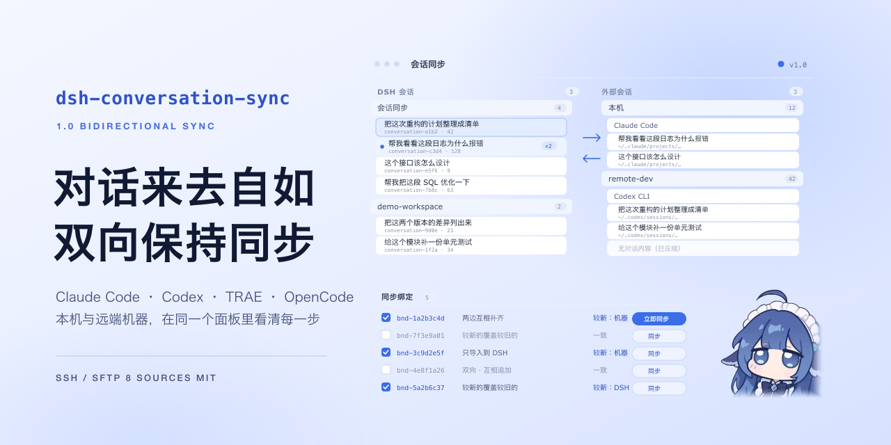

[中文](README.zh-CN.md) · **English**

# dsh-conversation-sync

[](https://www.npmjs.com/package/dsh-conversation-sync)
[](https://www.npmjs.com/package/dsh-conversation-sync)
[](https://www.npmjs.com/package/dsh-conversation-sync)
[](https://github.com/sheenisme/dsh-conversation-sync/blob/main/LICENSE)
[](https://github.com/topics/dsh-plugin)

Maintained by [@sheenisme](https://github.com/sheenisme) · [Homepage](https://github.com/sheenisme/dsh-conversation-sync) · [npm](https://www.npmjs.com/package/dsh-conversation-sync) · [Issue](https://github.com/sheenisme/dsh-conversation-sync/issues) · [中文](README.zh-CN.md)



Import conversations into [DeepSeek Harness](https://github.com/deepseek-ai/deepseek-harness)
from the tools you already use — and keep them in sync **both ways**, locally or
over SSH.

**Two headline features:**

1. **Real bidirectional sync.** New messages on either side propagate to the
   other. You choose the direction per pair of sessions: import, export, or
   either of the two-sided modes.
2. **Remote-SSH machines are first-class.** Sessions do not have to live on this
   machine. The plugin reads `~/.ssh/config` and treats the local machine, every
   SSH host, and every **jump host** as a source you can sync with.

## Install

```bash
dsh plugin --profile <name> add dsh-conversation-sync
```

Or from the UI: **Plugins → Install bundle**. The bundle ships its own
`cordis.patch.yml`, so nothing in your profile manifest has to be edited by hand.

## Quick start

1. Open the panel: **Settings → Conversation sync**, the **sidebar icon**, or
   **Plugins → Conversation sync** — both entries can be switched off
   independently on the page itself.
2. The right side lists the local machine plus every host from `~/.ssh/config`,
   jump hosts included. For an SSH machine, set the **private-key path** once;
   it is stored as a DSH credential, never as plugin config. Point it at the
   matching `.pub` file to authenticate through `ssh-agent`.
3. Select a session on **each** side — the left one is what gets written, the
   right one is the source or destination — then choose how they behave.
4. Every import lands in one `会话同步` workspace. A remote session's title is
   prefixed with its machine (`BAAI-Ascend · …`), because DSH requires a
   session's working directory to equal its workspace path; a per-machine folder
   would have to be its own workspace. Sessions imported by an older build that
   *did* create one workspace per machine are moved in on the next start.

## Supported sources

| Kind | Typical location |
| --- | --- |
| Claude Code | `~/.claude/projects/<slug>/<sessionId>.jsonl` |
| Codex CLI | `~/.codex/sessions/YYYY/MM/DD/rollout-*.jsonl` |
| WorkBuddy / CodeBuddy | `~/.workbuddy/projects/**`, `~/.workbuddy-ai/projects/**`, `~/.codebuddy/projects/**` |
| TRAE | `~/.trae/cli/**`, `~/.trae-cn/cli/**` |
| Antigravity | `~/.gemini/antigravity{,-cli,-ide}/brain/<uuid>/.system_generated/logs/transcript.jsonl` |
| OpenCode | `~/.local/share/opencode/opencode.db` (SQLite) |
| Generic JSONL | any JSONL file with `role` and `content`/`text` per line |
| DeepSeek export | web export ZIP (`export_format_version: 3`) |

OpenCode and the DeepSeek export are **import-only**: OpenCode keeps sessions in
a live SQLite database, and an export ZIP is a snapshot rather than a
conversation the tool can resume.

Each tool gets a different line shape, and syncing has to respect it: a Claude
Code file needs `parentUuid` chains and `tool_use`/`tool_result` blocks, a Codex
rollout needs `session_meta` plus ascending `ordinal` values. The exact rules,
per tool and per field, are in [docs/FORMATS.md](docs/FORMATS.md).

## Safety

Both directions go through the same three steps, so a sync either lands
completely or not at all:

1. **Pre-flight (read-only).** Data directory writable, source readable, target
   session present, direction known. A failed check refuses the sync *before*
   anything is touched, and names the check.
2. **Backup.** The external file and the DSH session's whole on-disk directory
   are copied aside, then read back — a backup that cannot be read aborts the
   sync.
3. **Verify, then roll back.** After writing, both sides are read again. A
   mismatch restores the previous state from the backups.

> **Warning — exporting modifies live files.** Export appends messages to the
> original tool's session files. Backups are taken before every write and
> restored on failure, but data loss is still possible. Leave the export
> direction off for sources you cannot afford to lose.

## Development

```bash
npm test        # unit tests, node:test, no network and no DSH needed
```

225 unit tests cover the pure modules; CI additionally installs the packed plugin
into five real DSH releases and drives the actual RPC surface through thirteen
scenarios. See [docs/TECHNICAL.md](docs/TECHNICAL.md#testing) for what each CI job
proves and how to run the harness locally.

## License

[MIT](LICENSE) © 2026 sheenisme

## Acknowledgements

- **[DeepSeek Harness](https://github.com/deepseek-ai/deepseek-harness)** (MIT) —
  the host. Its official `dsh-deepseek-chat-import` plugin and the session format
  packages were the reference for event shapes, the `tool/call` → `tool/result`
  lifecycle, and how a plugin registers a web route.
- **[dsh-remote](https://github.com/sheenisme/dsh-remote)** (MIT) — the model for
  the SSH layer: connection pooling, host-key fingerprinting, the key ordering
  that avoids tripping `MaxAuthTries`, and failure classification with actionable
  hints.
- **[dsh-chat-import](https://github.com/Nwflower/dsh-chat-import)** (MIT) — the
  reference for materializing sessions through `sessionPersistence`.
- **[DeepSeek Balance Whale Widget](https://github.com/meteornox/deepseek-balance-whale-widget)** —
  the little whale in the cover. Its `assets/` art is provided as-is (see
  [docs/ASSETS.md](docs/ASSETS.md)); this free, non-commercial project uses it
  unmodified, with credit, and will remove it on request.
- **[dsh-plugin-cc](https://github.com/cpj-dev/dsh-plugin-cc)** (MIT) — a clean
  example of a bundle's shape and of how to test a DSH plugin.
