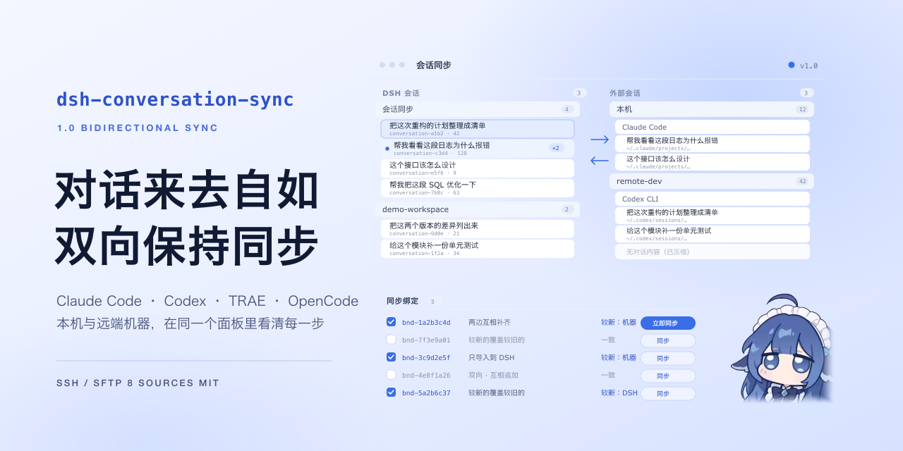

[English](README.md) · **中文**

# dsh-conversation-sync

[](https://www.npmjs.com/package/dsh-conversation-sync)
[](https://www.npmjs.com/package/dsh-conversation-sync)
[](https://www.npmjs.com/package/dsh-conversation-sync)
[](https://github.com/sheenisme/dsh-conversation-sync/blob/main/LICENSE)
[](https://github.com/topics/dsh-plugin)

由 [@sheenisme](https://github.com/sheenisme) 维护 · [主页](https://github.com/sheenisme/dsh-conversation-sync) · [npm](https://www.npmjs.com/package/dsh-conversation-sync) · [Issue](https://github.com/sheenisme/dsh-conversation-sync/issues) · [English](README.md)



把你在各种工具里的对话导入 [DeepSeek Harness](https://github.com/deepseek-ai/deepseek-harness)，
并且**双向**保持同步——本机或通过 SSH 的远端机器都可以。

**两个核心特性：**

1. **真正的双向同步。** 任意一侧新增的消息都会同步到另一侧。每一对会话的方向由你
   决定：导入、导出，或两种双向模式之一。
2. **Remote-SSH 机器是平级来源。** 会话不必在本机。插件读取 `~/.ssh/config`，把本机、
   每一台 SSH 主机、以及每一台**跳板机**都当作可同步的来源。

## 安装

```bash
dsh plugin --profile <name> add dsh-conversation-sync
```

也可以在界面里：**插件 → 安装 bundle**。bundle 自带 `cordis.patch.yml`，不需要手工
修改 profile 清单。

## 快速开始

1. 打开面板：**设置 → 会话同步**、**左侧边栏图标**，或 **插件 → 会话同步**——前两个
   入口默认都开，页面上的开关可以分别关掉。
2. 右侧列出本机以及 `~/.ssh/config` 里的每一台主机（含跳板机）。SSH 机器只需设置一次
   **私钥路径**，它保存为 DSH 凭据而不是插件配置。指向对应的 `.pub` 文件即可通过
   `ssh-agent` 认证。
3. 左右**各选一个**会话——左侧是被写入的一方，右侧是来源或目标——然后选择它们的行为。
4. 所有导入都落在同一个 `会话同步` 工作区。远端会话的标题会带上机器前缀
   （`BAAI-Ascend · …`），因为 DSH 要求会话的工作目录与工作区路径完全相等，按机器
   分文件夹就必须各自成为一个工作区。旧版本按机器分出去的工作区会在下次启动时自动
   合并进来。

## 支持的来源

| 类型 | 典型位置 |
| --- | --- |
| Claude Code | `~/.claude/projects/<slug>/<sessionId>.jsonl` |
| Codex CLI | `~/.codex/sessions/YYYY/MM/DD/rollout-*.jsonl` |
| WorkBuddy / CodeBuddy | `~/.workbuddy/projects/**`、`~/.workbuddy-ai/projects/**`、`~/.codebuddy/projects/**` |
| TRAE | `~/.trae/cli/**`、`~/.trae-cn/cli/**` |
| Antigravity | `~/.gemini/antigravity{,-cli,-ide}/brain/<uuid>/.system_generated/logs/transcript.jsonl` |
| OpenCode | `~/.local/share/opencode/opencode.db`（SQLite） |
| 通用 JSONL | 每行带 `role` 和 `content`/`text` 的 JSONL |
| DeepSeek 导出 | 网页导出的 ZIP（`export_format_version: 3`） |

OpenCode 和 DeepSeek 导出是**只导入**的：OpenCode 的会话在一个活跃的 SQLite 库里，
而导出 ZIP 是快照，不是工具能继续的对话。

每种工具的行格式都不一样，同步必须按各自的格式来：Claude Code 的文件需要
`parentUuid` 链和 `tool_use`/`tool_result` 块，Codex 的 rollout 需要 `session_meta`
和递增的 `ordinal`。逐工具、逐字段的规则见 [docs/FORMATS.zh-CN.md](docs/FORMATS.zh-CN.md)。

## 安全性

两个方向都走同样三步，所以一次同步要么完整落地，要么完全不动：

1. **事前检查（只读）。** 数据目录可写、来源可读、目标会话存在、方向已知。任一检查
   不过就在**动手之前**拒绝，并指出是哪一项。
2. **备份。** 外部文件与 DSH 会话的整个磁盘目录都复制一份，然后读回校验——读不回来
   的备份不算备份，同步中止。
3. **校验，失败则回滚。** 写入后重新读两侧。不一致就从备份还原到之前的状态。

> **警告——导出会修改活跃文件。** 导出会把消息追加到原工具的会话文件里。每次写入前
> 都会备份、失败会自动还原，但仍可能发生数据丢失。对不能承受丢失的来源，请关掉导出。

## 开发

```bash
npm test        # 单元测试，node:test，不需要网络也不需要 DSH
```

225 个单元测试覆盖纯模块；CI 另外会把打包后的插件装进五个真实 DSH 版本，并通过十三个
场景驱动真实的 RPC 接口。每个 CI 任务证明了什么、如何在本地跑测试环境，见
[docs/TECHNICAL.zh-CN.md](docs/TECHNICAL.zh-CN.md#testing)。

## 许可证

[MIT](LICENSE) © 2026 sheenisme

## 致谢

- **[DeepSeek Harness](https://github.com/deepseek-ai/deepseek-harness)**（MIT）——
  宿主本身。官方 `dsh-deepseek-chat-import` 插件与 session format 包是事件形状、
  `tool/call` → `tool/result` 生命周期、以及插件如何注册 Web 路由的参考。
- **[dsh-remote](https://github.com/sheenisme/dsh-remote)**（MIT）——SSH 层的范本：
  连接池、主机密钥指纹、避免触发 `MaxAuthTries` 的密钥排序、以及可操作的失败分类。
- **[dsh-chat-import](https://github.com/Nwflower/dsh-chat-import)**（MIT）——通过
  `sessionPersistence` 物化会话的参考。
- **[DeepSeek 余额小挂件](https://github.com/meteornox/deepseek-balance-whale-widget)** ——
  封面图里的小鲸鱼，其 `assets/` 素材为原样提供（见 [docs/ASSETS.zh-CN.md](docs/ASSETS.zh-CN.md)）；本插件免费且非商用，在此原样使用并致谢，如作者要求会立即移除。
- **[dsh-plugin-cc](https://github.com/cpj-dev/dsh-plugin-cc)**（MIT）——bundle 结构与
  如何为 DSH 插件写测试的干净示例。
